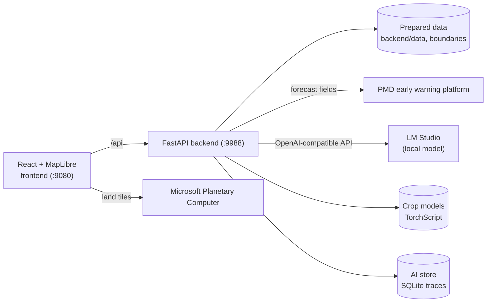

# Climate Smart Agriculture Portal

[](https://github.com/imtiazNDMA/climatesmartagri/actions/workflows/ci.yml)

A map-first portal that brings Pakistan's agriculture, climate, water, forecast and hazard information into one place for disaster management stakeholders, and helps them read it. Every section has figures and charts for the country, a province or a district. A local AI guide answers questions from the portal's own data, and an image screener helps identify crop diseases and pests.

## What the portal shows

| Section | What a reader gets | Coverage |
| --- | --- | --- |
| **Land Classification** | Annual land classification (Trees, Rangeland, Bare ground, Crops, Built area), class areas and net change between years | 2017–2023, every district |
| **Climate Smart Irrigation Practices** | Surface water and groundwater irrigation, equipped and irrigated area, and a recommended practice for each tehsil | Every district |
| **Greenhouse-gas emissions** | Carbon dioxide, methane and nitrous oxide over time | 1994–2025, national |
| **Crop water balance** | Water available against water crops need, at different irrigation efficiencies | 2026–2047, national |
| **Food security projections** | Food needed against supply under climate-smart and traditional farming | 2026–2047, national |
| **Climate-smart crop calendar** | Traditional and adjusted sowing and harvest windows | Each province |
| **Weather forecast** | 47 forecast layers from 8 models (PMD, ECMWF, CMA and others), stepped through model time | Live, on demand |
| **Hazards** | District-level low, medium and high guidance for frost, heat stress, heavy rain, strong wind and low visibility | Live, from the forecast |
| **AI Crop Disease and Pest Detector** | Screens leaf images of rice, maize, cotton, wheat and sugarcane, with symptoms and prevention for the likely class | Five crops |
| **Exposure and vulnerability** | Coming soon | — |

Hazard guidance is model-derived and **is not an official warning**. Crop screening is **not a diagnosis**: uncertain results ask for expert review, and treatment steps are held back until an agronomist has reviewed the guidance.

## AI features

- **Portal guide.** An assistant that answers questions about any section, place or year by calling fact tools over the portal's data. Every number in an answer is checked against the facts it was given, and the panel says when one could not be checked. It can also change the view on request ("show Lahore's land classification for 2019"). It runs on a local model through LM Studio by default ([ADR 0001](docs/adr/0001-local-language-model-by-default.md)), so questions do not leave the machine.
- **Crop disease and pest detector.** PyTorch models packaged as TorchScript. A five-crop ConvNeXt-Nano model (calibrated, with a review threshold chosen on validation data) serves cotton, wheat and sugarcane; an earlier model serves rice and maize. Training, evaluation and calibration live in [`ml/crop-disease`](ml/crop-disease/README.md).
- **Evaluation and AI Ops.** The assistant is scored on a golden question set and an adversarial set (prompt injection, invented figures, requests for official warnings). Every answer leaves a trace, and a token-protected dashboard at `/ops` shows usage, latency, evaluation runs and traces.

## Architecture



- **One catalogue drives the interface.** `backend/catalogue.json` describes every section and layer; the frontend builds its rail, panels, legends and time slider from it.
- **Prepared data, never edited sources.** Scripts in `backend/scripts/` turn the raw files in `data/` into what the backend serves.
- **The browser never talks to the language model.** Only the backend calls LM Studio, and it treats everything in the prompt context as data, not instructions.
- **Land classification tiles** come straight from Microsoft Planetary Computer ([ADR 0003](docs/adr/0003-land-classification-tiles-from-planetary-computer.md)); per-district statistics are prepared ahead of time.

## Getting started

### Requirements

- [uv](https://docs.astral.sh/uv/) (Python 3.13 is installed by uv)
- Node.js 22.12 or later
- Internet access for the background map, land tiles and forecasts
- Optional: [LM Studio](https://lmstudio.ai/) for the portal guide's answers, and an NVIDIA GPU for training crop models

### Run the portal

On Windows, double-click **`start-portal.cmd`**. It installs anything missing, starts both servers and opens the portal; if the portal is already running it just opens it. Close the window to stop it.

Or by hand:

```sh
uv sync --group ml        # Python dependencies, including PyTorch for crop screening
npm ci
npm --prefix frontend ci
npm run dev               # backend on :9988, frontend on :9080, opens the browser
```

Copy `.env.example` to `.env` only when you need local overrides or PMD credentials. Never commit `.env`.

### Turn on the portal guide

1. Install LM Studio, download a Qwen instruct model and start its local server on `127.0.0.1:1234`.
2. Set `CSA_LM_STUDIO_MODEL` in `.env` if the model's identifier differs from the default `qwen/qwen3.8-27b`.
3. Restart the portal and open **AI portal guide** at the bottom of the left rail.

The overview and the guided tour work without a model; questions return a clear "unavailable" message until one is running. Keep LM Studio bound to loopback unless it is separately authenticated.

### Crop models

The model packages live in `backend/models/crop-classification/` (`improved-002` and `five-crop-001`). The TorchScript weights (`model.ts`) are not kept in git; place them in each package folder, or point `CSA_CROP_MODEL_DIR` and `CSA_FIVE_CROP_MODEL_DIR` at another package.

## Preparing data

Restart the portal after running any of these.

| Command | What it does |
| --- | --- |
| `uv run python backend/scripts/prepare_data.py` | Boundaries, irrigation, emissions, water balance, food security and the crop calendar → `backend/boundaries/`, `backend/data/` (about a minute) |
| `uv run python backend/scripts/prepare_land_cover_stats.py` | Annual land-classification figures per district from Planetary Computer → `backend/data/land_cover_annual.json`. Without it the Land Classification section has no figures. |
| `uv run python backend/scripts/prepare_rasters.py` | Converts the irrigated/rainfed raster to a Cloud-Optimized GeoTIFF in `backend/rasters/` (not in git), served by TiTiler inside the backend |
| `uv run python backend/scripts/import_treatment_guide.py <guide>` | Rebuilds the crop guidance file `backend/crop_guidance.json` from the treatment guide |

## Quality checks

```sh
npm run check   # lint, backend tests, recorded assistant evaluation, frontend unit tests, production build
npm test        # everything above plus the Playwright browser tests
```

Install the test browser once with `npm --prefix frontend exec playwright install chromium`. CI runs both suites on every pull request.

### Evaluating the assistant

The datasets are in `backend/evaluations/`. Scorers check that numbers are grounded in the facts, the right section is named, refusals and "not available" answers are recognised, the hazard disclaimer is kept, and the expected tools were called.

- `npm run eval:recorded` replays recorded model turns (`backend/evaluations/cassettes/`) through the real tools and scorers, and fails if a dataset's pass rate drops below `backend/evaluations/baseline.json`. This is what CI runs: it has no model, so it catches changes to tools, facts, the agent loop and the scorers.
- `npm run eval:live` asks the configured model every case three times and writes a report to `docs/evaluations/`.

After changing a prompt or the model, re-record and update the baseline:

```sh
uv run python backend/scripts/evaluate.py --mode live --record
uv run python backend/scripts/evaluate.py --write-baseline backend/evaluations/baseline.json
```

After changing a case's view or expected tools, run `uv run python backend/scripts/fill_eval_facts.py`.

## Deployment

```sh
npm run build
npm run start:api   # FastAPI on 0.0.0.0:9988
npm run start:web   # built frontend on 0.0.0.0:9080, proxying /api to CSA_BACKEND_URL
```

Both bind to all interfaces, so other machines on the network can open `http://<this-machine>:9080`. On Windows, allow Node.js and Python through the firewall when asked. For a public deployment, put both behind a reverse proxy with TLS and route `/api` to the FastAPI service. The `Dockerfile` builds an image that runs the API on port 9988.

## Configuration

All settings are environment variables, read from `.env` at the repository root.

| Variable | Default | Purpose |
| --- | --- | --- |
| `CSA_CATALOGUE_PATH` | `backend/catalogue.json` | Section and layer catalogue |
| `CSA_BOUNDARIES_DIR` | `backend/boundaries` | Boundary GeoJSON |
| `CSA_DATA_DIR` | `backend/data` | Prepared section data |
| `CSA_RASTERS_DIR` | `backend/rasters` | Converted rasters served by TiTiler |
| `CSA_FORECAST_LAYERS_PATH` | `backend/forecast_layers.json` | Forecast layer registry |
| `CSA_FORECAST_DIR` | `backend/forecast` | Forecast cache |
| `CSA_PMD_URL`, `CSA_PMD_USER`, `CSA_PMD_PASS` | empty | PMD early warning platform access |
| `CSA_HAZARD_PRODUCTS` | `backend/hazard_products.json` | Hazard products: thresholds, units, severity bands |
| `CSA_HAZARD_MODELS` | `backend/hazard_models.json` | Forecast-derived hazard models (e.g. frost degree-hours) |
| `CSA_CROP_MODEL_DIR` | `backend/models/crop-classification/improved-002` | Rice and maize model package |
| `CSA_FIVE_CROP_MODEL_DIR` | `backend/models/crop-classification/five-crop-001` | Cotton, wheat and sugarcane model package |
| `CSA_CROP_GUIDANCE` | `backend/crop_guidance.json` | Symptoms, prevention and (once reviewed) treatment guidance |
| `CSA_LM_STUDIO_URL` | `http://127.0.0.1:1234` | LM Studio server |
| `CSA_LM_STUDIO_MODEL` | `qwen/qwen3.8-27b` | Model identifier as LM Studio shows it |
| `CSA_LM_STUDIO_API_KEY` | empty | Optional LM Studio API key |
| `CSA_LM_STUDIO_TIMEOUT` | `60` | Generation timeout in seconds |
| `CSA_AI_CONCURRENCY` | `1` | Questions answered at once |
| `CSA_AI_QUEUE_SECONDS` | `5` | How long a question waits for a slot before "busy" |
| `CSA_AI_DB` | `backend/ai.db` | AI store (traces, evaluation runs); empty turns it off |
| `CSA_TRACE_CONTENT` | off | `1` keeps question and answer text in traces (otherwise only a hash) |
| `CSA_TRACE_RETENTION_DAYS` | `30` | Live traces older than this are deleted at startup |
| `CSA_OTLP_ENDPOINT` | empty | Optional OpenTelemetry (OTLP/HTTP) export of traces |
| `CSA_OPS_TOKEN` | empty | Enables the AI Ops API and `/ops` dashboard; required to use them |
| `CSA_JUDGE_URL`, `CSA_JUDGE_MODEL` | LM Studio URL, empty | Optional LLM judge for evaluations |

## Project layout

```
backend/
  csa_portal/        FastAPI application: sections, facts, forecast, hazards, crop screening
    ai/              agent runtime, tools, tracing, AI store, evaluations, AI Ops API
  scripts/           data preparation, evaluation and development scripts
  evaluations/       assistant datasets, recorded cassettes, baseline
  tests/             pytest suite
frontend/
  src/               React application (MapLibre map, panels, charts, assistant, /ops dashboard)
  e2e/               Playwright browser tests
ml/crop-disease/     crop disease dataset manifest, training, evaluation, calibration, packaging
data/                raw source datasets (large rasters are not in git)
docs/                ADRs, evaluation reports, plans and contributor notes
```

## Documentation

- [`CONTEXT.md`](CONTEXT.md): the domain language used across code, issues and the interface.
- [`docs/adr/`](docs/adr/): architecture decisions.
- [`docs/evaluations/`](docs/evaluations/): assistant and crop model evaluation reports.
- [`docs/development.md`](docs/development.md): notes for contributors.

## Contributing

Work is tracked in [GitHub Issues](https://github.com/imtiazNDMA/climatesmartagri/issues). Each ticket gets its own branch (`feat/<issue>-<slug>` or `fix/...`) and a pull request into `main` that says `Closes #<issue>`. Pull requests are merged with a merge commit once CI is green, and the branch is then deleted.

## Data sources

- Land classification: Esri / Impact Observatory annual land use and land cover (`io-lulc-annual-v02`, 10 m) via Microsoft Planetary Computer.
- Weather forecasts: Pakistan Meteorological Department's early warning platform.
- Greenhouse-gas emissions: Pakistan's Third National Communication to the UNFCCC (2025).
- Irrigation, crop water balance, food security projections and the crop calendar: datasets prepared for the project, in `data/`.
- Crop images: about 18,000 leaf images across 40 class folders, kept outside git and catalogued by a manifest in [`ml/crop-disease`](ml/crop-disease/README.md).
- Background map: [OpenFreeMap](https://openfreemap.org/), with data from OpenStreetMap contributors.
