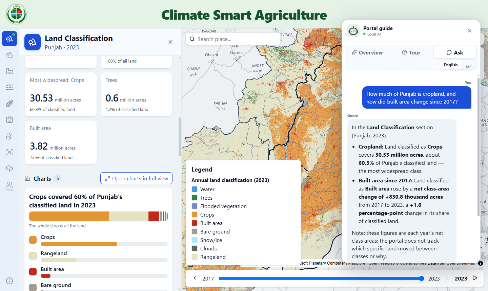
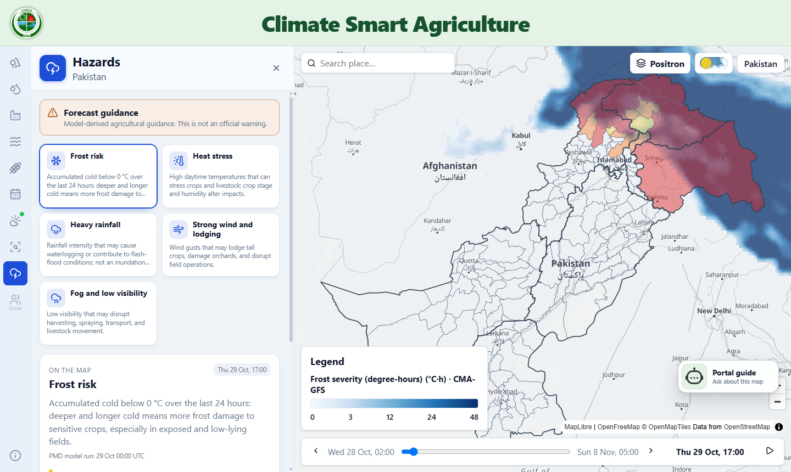
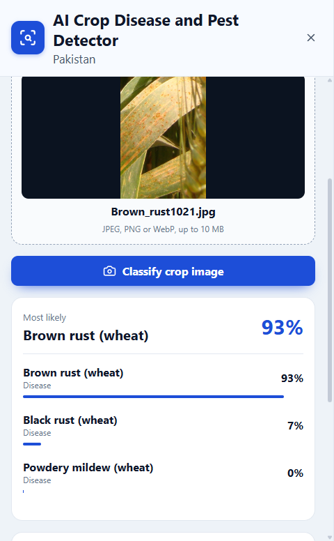
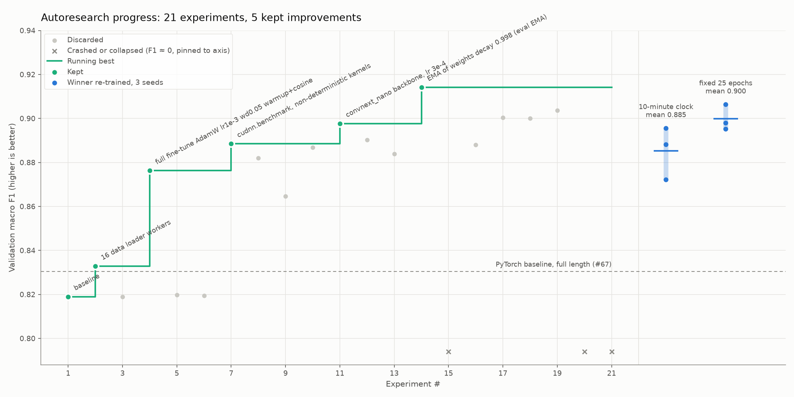
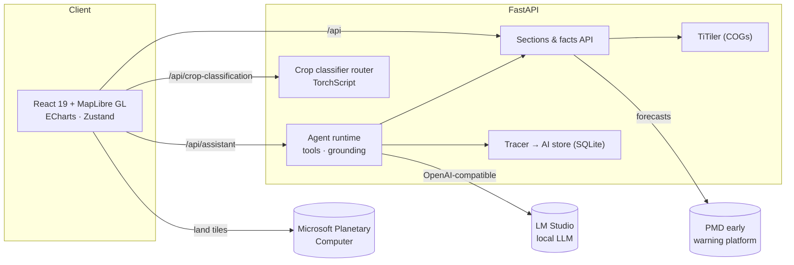

<div align="center">

# Climate Smart Agriculture Portal

**A map-first decision platform for Pakistan's agriculture, climate and hazard data, with a grounded AI assistant and a calibrated crop disease detector.**

[](https://github.com/imtiazNDMA/climatesmartagri/actions/workflows/ci.yml)




<sub>Punjab's 2023 land classification, the figures and charts behind it, and the AI guide answering from those same figures.</sub>

</div>

---

## Why it exists

Disaster management officers in Pakistan need to know what is growing where, how the land is changing, and what the next days' weather means for farmers. That information is spread across satellite products, weather models, spreadsheets and reports. This portal brings it together on one map. Every section works for the whole country, a province or any district, and an AI guide explains what is on screen in plain language.

## Highlights

| | |
| --- | --- |
| **10 sections, one map** | Land classification (2017–2023), irrigation, emissions, water balance, food security, crop calendar, live weather forecasts, hazards, crop disease detection |
| **47 live forecast layers** | From 8 numerical weather models (PMD, ECMWF, CMA and others), turned into district-level frost, heat, rain, wind and visibility guidance |
| **Grounded AI guide** | A tool-calling agent on a local LLM; every number in an answer is checked against the data it was given |
| **Crop disease detector** | 37 classes across 5 crops; **0.959 test accuracy, 0.898 macro F1**, temperature-calibrated with an expert-review threshold |
| **Tested end to end** | About 600 backend tests, 300+ frontend unit tests, 90+ Playwright browser tests, and an LLM evaluation gate in CI |
| **Observable AI** | OpenTelemetry-style traces for every answer, a SQLite AI store and a token-protected ops dashboard |

## A look inside

<table>
  <tr>
    <td width="62%"></td>
    <td width="38%"></td>
  </tr>
  <tr>
    <td><b>Hazards.</b> Frost risk per district, computed from a weather model's run as accumulated degree-hours below 0 °C, with the model and run time on screen. Model guidance, clearly labelled as not an official warning.</td>
    <td><b>Crop detector.</b> A held-out wheat leaf correctly identified as brown rust. Symptoms and prevention follow; treatment is held back until an agronomist reviews it.</td>
  </tr>
</table>

## Engineering highlights

### A grounded, tool-calling AI assistant
- **Agent loop over a facts layer.** The model calls typed tools (`find_place`, `get_section_facts`, `get_district_risk`, `get_crop_calendar`) instead of seeing raw data. Every value a chart draws is exposed as a fact with its source.
- **Numeric grounding on every answer.** A checker extracts each figure the model writes and matches it against the facts it was given, allowing only display rounding. The reader is told when a figure could not be checked.
- **It can drive the UI, safely.** A `set_portal_view` tool lets the assistant open sections, select places, years and layers, and show forecasts. Every requested change is validated on the server before the frontend applies it.
- **Prompt-injection aware.** Portal data and conversation history go into the prompt marked as untrusted data, and an adversarial test set probes injection through questions, place names and history.
- **Local by default.** It runs on a local model through LM Studio ([ADR 0001](docs/adr/0001-local-language-model-by-default.md)), so readers' questions never leave the machine. A concurrency limit and a bounded queue keep the GPU from being overloaded.

### LLM evaluation as part of CI
- **Golden and adversarial datasets** are scored on grounded numbers, naming the right section, refusals, the hazard disclaimer, the tools called, and safety.
- **Cassette replay.** A live run records the model's turns. CI replays them through the *real* tools, agent loop and scorers, so it catches regressions with no GPU, and fails when a pass rate drops below the recorded baseline.
- **An LLM judge calibrated against humans.** Its grades only count once its agreement with human labels reaches Cohen's κ ≥ 0.6.

### Observability for the AI
- **Traces for every answer.** Traces and nested `agent` / `llm` / `tool` spans use OpenTelemetry GenAI attribute names and record token usage, with optional OTLP/HTTP export.
- **The AI store.** SQLite in WAL mode with numbered schema migrations, retention, and privacy by default: questions are kept only as a SHA-256 unless content capture is switched on.
- **Failure never reaches the reader.** A failing store or exporter is counted and shown on `/api/health`, but never breaks an answer.
- **AI Ops dashboard at `/ops`.** Usage, latency, failure rate, evaluation runs compared side by side, traces, and a queue for human labelling.

### A reproducible computer-vision pipeline
- **Leak-free data.** About 18,000 images are deduplicated by SHA-256 and perceptual hash. Each group of copies keeps one image in exactly one of train, val and test, so no picture is both trained on and scored, and the manifest rebuilds byte for byte.
- **Automated experiment loop** tracked in MLflow. ConvNeXt-Nano with EMA beat a MobileNetV2 baseline by **+0.106 test macro F1**, selected on validation only.
- **Reproducible results.** A wall-clock training budget made scores depend on GPU load. Switching to a fixed-epoch schedule made results reproducible across three seeds (validation macro F1 0.898 / 0.895 / 0.906).
- **Calibrated confidence.** Temperature scaling (T = 1.33) halves expected calibration error (test ECE 0.0166 → 0.0085). The expert-review threshold is chosen on validation for 98% accuracy above it.
- **Verified packaging.** TorchScript packages carry the crop mask and the temperature, and are checked against the training checkpoint. Across all 1,720 test images there are 0 top-1 disagreements.

<p align="center"></p>

### Geospatial at country scale
- **A catalogue-driven interface.** One JSON catalogue describes every section and layer, and the React app builds its navigation, panels, legends and time slider from it.
- **Satellite land classification** comes straight from Microsoft Planetary Computer. The backend registers one mosaic per year over exactly the scenes that cover Pakistan ([ADR 0003](docs/adr/0003-land-classification-tiles-from-planetary-computer.md)). Per-district statistics are prepared ahead of time.
- **Cloud-Optimized GeoTIFFs** are served by TiTiler inside the API. Forecast fields are fetched on demand from PMD's early-warning platform and crossfaded between time steps.
- **Charts that state the finding.** Every chart headline is a sentence computed from the data, such as "Crops covered 60% of Punjab's classified land in 2023".

## Architecture



## Tech stack

| Layer | Technologies |
| --- | --- |
| **Frontend** | React 19, TypeScript, Vite, MapLibre GL, ECharts, Zustand, Vitest, Playwright |
| **Backend** | Python 3.13, FastAPI, Pydantic, TiTiler, GeoPandas, Rasterio, httpx, uv |
| **AI / LLM** | Tool-calling agent on an OpenAI-compatible API (LM Studio, Qwen), custom evaluation harness, LLM-as-judge with human-label calibration, OpenTelemetry GenAI spans |
| **Machine learning** | PyTorch, timm (ConvNeXt), TorchScript, MLflow, temperature scaling |
| **Data** | Microsoft Planetary Computer (STAC, mosaics), Cloud-Optimized GeoTIFF, GeoJSON, SQLite |
| **Delivery** | GitHub Actions CI (lint, tests, LLM eval gate, build, browser tests), Docker |

## Getting started

**Requirements:** [uv](https://docs.astral.sh/uv/), Node.js 22.12+, and internet access for the base map, land tiles and forecasts. Optional: [LM Studio](https://lmstudio.ai/) for the assistant's answers, and an NVIDIA GPU for training.

```sh
uv sync --group ml        # Python dependencies, including PyTorch for crop screening
npm ci && npm --prefix frontend ci
npm run dev               # API on :9988, web on :9080, opens the browser
```

On Windows, `start-portal.cmd` does all of this in one double-click. For the assistant, start LM Studio's server on `127.0.0.1:1234` with a Qwen instruct model; the overview and the guided tour work without it.

<details>
<summary><b>Preparing data</b></summary>

| Command | Output |
| --- | --- |
| `uv run python backend/scripts/prepare_data.py` | Boundaries, irrigation, emissions, water balance, food security, crop calendar → `backend/boundaries/`, `backend/data/` |
| `uv run python backend/scripts/prepare_land_cover_stats.py` | Annual land-classification figures per district from Planetary Computer |
| `uv run python backend/scripts/prepare_rasters.py` | Cloud-Optimized GeoTIFF of irrigated/rainfed cropland (not in git) |
| `uv run python backend/scripts/import_treatment_guide.py <guide>` | Crop guidance file from the agronomy treatment guide |

The crop model weights (`model.ts`) are not in git. Place them in `backend/models/crop-classification/<package>/`.

</details>

<details>
<summary><b>Tests and evaluation</b></summary>

```sh
npm run check           # lint, backend tests, recorded LLM evaluation gate, unit tests, build
npm test                # all of the above plus Playwright browser tests
npm run eval:live       # ask the local model every evaluation case three times and write a report
```

After changing a prompt or the model, re-record the cassettes and the baseline:

```sh
uv run python backend/scripts/evaluate.py --mode live --record
uv run python backend/scripts/evaluate.py --write-baseline backend/evaluations/baseline.json
```

</details>

<details>
<summary><b>Deployment</b></summary>

```sh
npm run build
npm run start:api       # FastAPI on 0.0.0.0:9988
npm run start:web       # built frontend on 0.0.0.0:9080, proxying /api to CSA_BACKEND_URL
```

For a public deployment, put both behind a reverse proxy with TLS. The `Dockerfile` builds an image that runs the API.

</details>

<details>
<summary><b>Configuration</b> (environment variables, read from <code>.env</code>)</summary>

| Variable | Default | Purpose |
| --- | --- | --- |
| `CSA_CATALOGUE_PATH` | `backend/catalogue.json` | Section and layer catalogue |
| `CSA_BOUNDARIES_DIR` | `backend/boundaries` | Boundary GeoJSON |
| `CSA_DATA_DIR` | `backend/data` | Prepared section data |
| `CSA_RASTERS_DIR` | `backend/rasters` | Rasters served by TiTiler |
| `CSA_FORECAST_LAYERS_PATH` | `backend/forecast_layers.json` | Forecast layer registry |
| `CSA_FORECAST_DIR` | `backend/forecast` | Forecast cache |
| `CSA_PMD_URL`, `CSA_PMD_USER`, `CSA_PMD_PASS` | empty | PMD early-warning platform access |
| `CSA_HAZARD_PRODUCTS` | `backend/hazard_products.json` | Hazard thresholds, units, severity bands |
| `CSA_HAZARD_MODELS` | `backend/hazard_models.json` | Forecast-derived hazard models |
| `CSA_CROP_MODEL_DIR` | `…/improved-002` | Rice and maize model package |
| `CSA_FIVE_CROP_MODEL_DIR` | `…/five-crop-001` | Cotton, wheat and sugarcane model package |
| `CSA_CROP_GUIDANCE` | `backend/crop_guidance.json` | Symptoms, prevention, reviewed treatment |
| `CSA_LM_STUDIO_URL` | `http://127.0.0.1:1234` | LM Studio server |
| `CSA_LM_STUDIO_MODEL` | `qwen/qwen3.8-27b` | Model identifier |
| `CSA_LM_STUDIO_API_KEY` | empty | Optional API key |
| `CSA_LM_STUDIO_TIMEOUT` | `60` | Generation timeout (s) |
| `CSA_AI_CONCURRENCY` | `1` | Questions answered at once |
| `CSA_AI_QUEUE_SECONDS` | `5` | Wait for a slot before "busy" |
| `CSA_AI_DB` | `backend/ai.db` | AI store; empty turns it off |
| `CSA_TRACE_CONTENT` | off | `1` keeps question and answer text |
| `CSA_TRACE_RETENTION_DAYS` | `30` | Live trace retention |
| `CSA_OTLP_ENDPOINT` | empty | Optional OTLP/HTTP trace export |
| `CSA_OPS_TOKEN` | empty | Enables the AI Ops API and `/ops` |
| `CSA_JUDGE_URL`, `CSA_JUDGE_MODEL` | LM Studio URL, empty | Optional LLM judge |

</details>

## Project layout

```
backend/
  csa_portal/          FastAPI app: sections, facts, forecast, hazards, crop screening
    ai/                agent runtime, tools, tracing, AI store, evaluations, ops API
  evaluations/         LLM datasets, recorded cassettes, pass-rate baseline
  scripts/  tests/     data preparation and evaluation; pytest suite
frontend/
  src/                 React app: map, panels, charts, assistant, /ops dashboard
  e2e/                 Playwright browser tests
ml/crop-disease/       dataset manifest, training, autoresearch, calibration, packaging
docs/                  architecture decisions, evaluation reports, screenshots
```

## Engineering practice

- **One branch and pull request per issue**, with CI (lint, about 1,000 tests, the LLM evaluation gate, build) required to be green before merging.
- **Test-first development** for backend and frontend behaviour.
- **Architecture decisions** are recorded as [ADRs](docs/adr/), and the domain language is fixed in [`CONTEXT.md`](CONTEXT.md).
- **Evaluation reports** for the assistant and the crop models are kept in [`docs/evaluations/`](docs/evaluations/).

## Data sources

Esri / Impact Observatory annual land use and land cover (`io-lulc-annual-v02`) via Microsoft Planetary Computer · Pakistan Meteorological Department forecasts · Pakistan's Third National Communication to the UNFCCC (emissions) · project datasets for irrigation, water balance, food security and the crop calendar · base map © [OpenFreeMap](https://openfreemap.org/), data © OpenStreetMap contributors.
